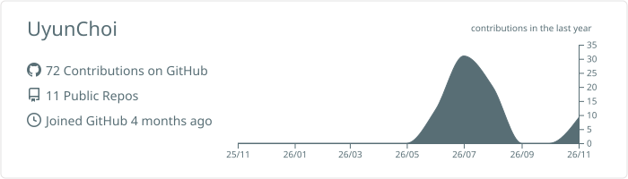

### Tech Stack

**Backend & Architecture**

**Database & DevOps**

**Backend & Architecture**  
**Database & ORM**  
**Infrastructure & DevOps**  
  
---

### Core Projects

| 프로젝트명 | 핵심 역할 및 아키텍처 성과 | 주요 사용 기술 |
| :--- | :--- | :--- |
| **co-panion** | **B2B 멀티테넌시 컨텍스트 스위칭 파이프라인 구축** - Turbo 기반 풀스택 모노레포 환경 구성 및 CI/CD 자동화 - Azure Container Apps를 활용한 클라우드 배포 | NestJS, Next.js, Prisma, Azure |
| **Spyd** | **로컬 우선(Local-first) 동기화 및 지식 관리 시스템 설계** - 델타 로깅 스키마 설계를 통한 데이터 추출 및 동기화 마련 - 상태별 동적 뷰(Kanban, List) 변환 구현 | TypeScript, React, PostgreSQL |

---
| 프로젝트명 | Tech Stack | 핵심 요약 및 성과 | Link |
| :--- | :--- | :--- | :--- |
| **Spyd** | `NestJS`, `PostgreSQL` | 2D 좌표 기반 데이터 추출 및 지식 관리 애플리케이션 | [Repo](링크) |
| **co-panion** | `Turbo`, `Azure` | CI/CD 파이프라인 자동화를 적용한 모노레포 아키텍처 기반 서비스 | [Repo](링크) |
| **Porto-Sync** | `Spring`, `JSONB` | 글로벌 스탠더드 데이터 모델을 적용한 채용 정보 통합 플랫폼 | [Repo](링크) |

### 📊 GitHub Activity & Metrics

<!-- github-profile-summary-cards 파이프라인 연동 결과물 (매일 자동 갱신) -->

### GitHub Activity Overview

## 📊 GitHub Analytics

<table align="center" style="border: none;">
  <tr>
    <td align="center" width="50%">
      
    </td>
    <td align="center" width="50%">
      
    </td>
  </tr>
  <tr>
    <td align="center" width="50%">
      
    </td>
    <td align="center" width="50%">
      
    </td>
  </tr>
</table>
